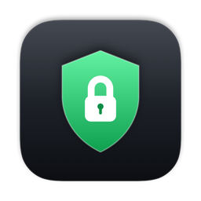
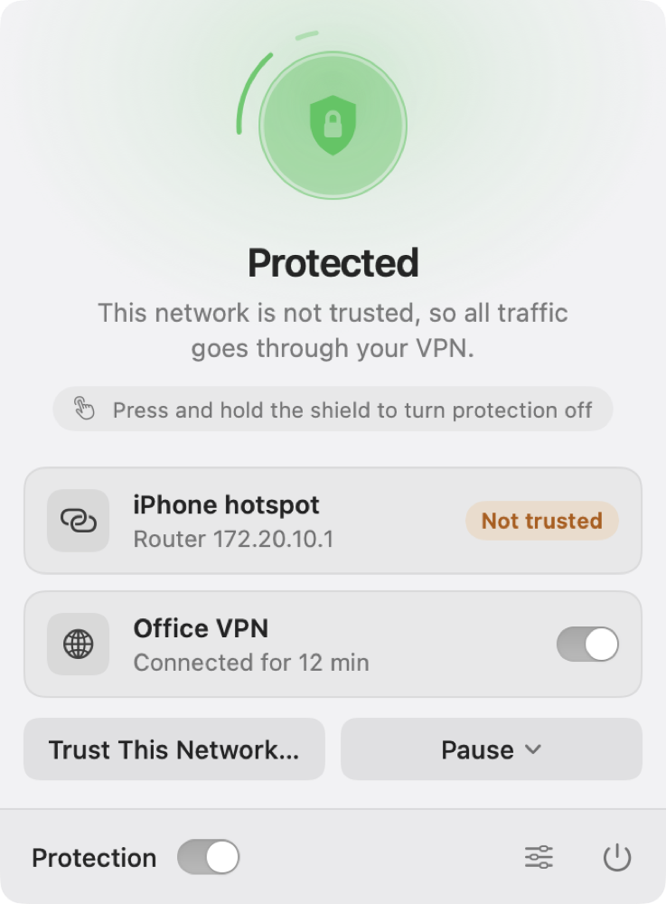
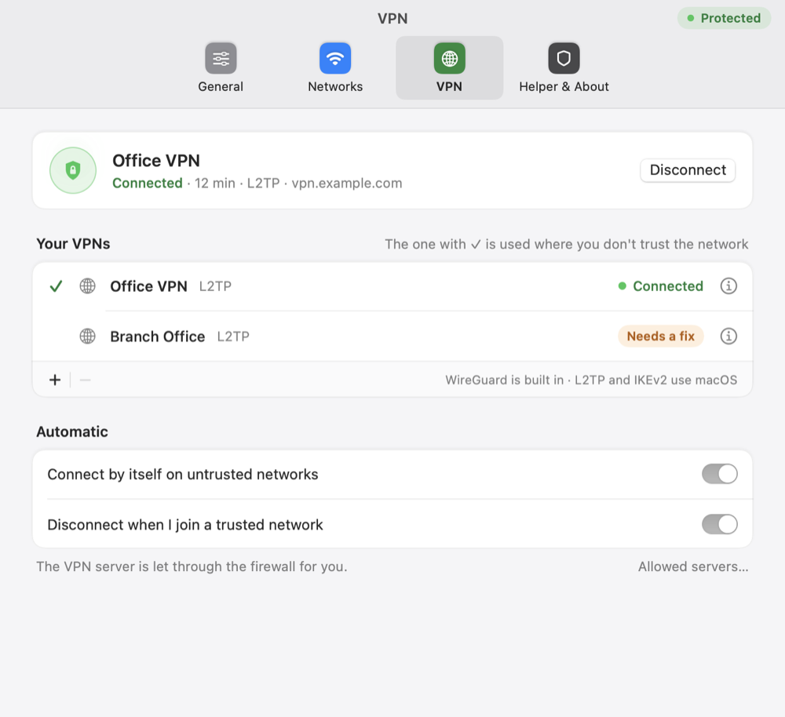
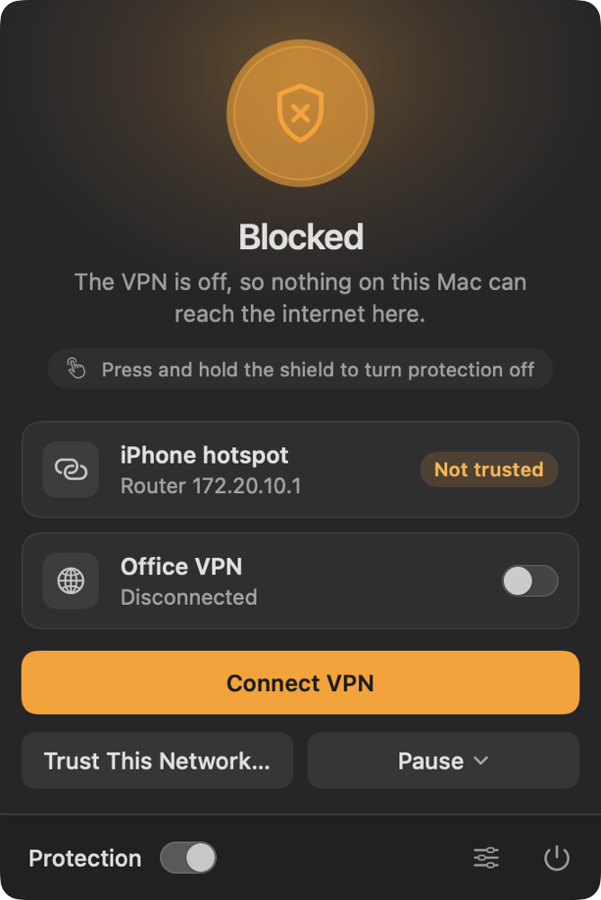
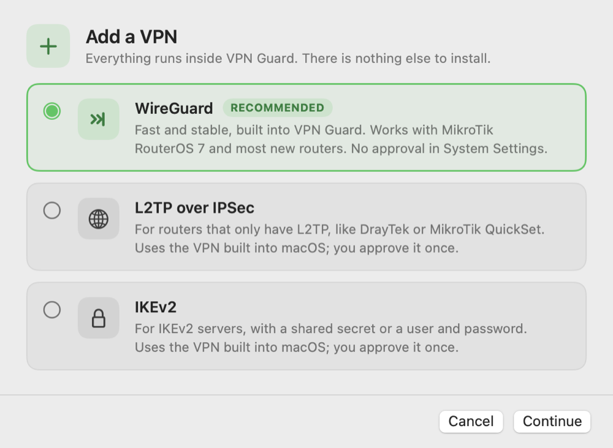

<p align="center">
  
</p>

<h1 align="center">VPN Guard</h1>

<p align="center">
  <b>Away from home and the office, only your VPN gets online.</b><br>
  A native macOS menu bar app with a firewall kill switch and a built-in WireGuard client.
</p>

<p align="center">
  <a href="https://github.com/hkvn/vpn-guard/actions/workflows/ci.yml"></a>
  
  
  <a href="LICENSE"></a>
</p>

<p align="center">
  
  &nbsp;&nbsp;
  
</p>

## Why

At the office or at home you are on a network you trust. Anywhere else (a café, a hotel, an airport,
your phone's hotspot) every request should go through your VPN. A normal VPN client does not guarantee
that: before it connects, while it reconnects, or when it drops, apps talk to the internet directly.

VPN Guard fixes this with one rule:

- **On a trusted network** (office, home): normal internet.
- **Anywhere else**: only the VPN can reach the internet. If the VPN is off, nothing gets out.

## Features

- **Kill switch in the macOS firewall (pf).** Lock mode allows only DHCP, a ping to the local router,
  and traffic to your VPN server. Everything else is refused, IPv6 included. It keeps working when the
  app is closed.
- **Trusted networks by router hardware address**, not Wi‑Fi name (anyone can copy a Wi‑Fi name).
- **Event driven.** The helper reacts to macOS network changes in milliseconds. No polling.
- **Fails closed.** No network, an unknown router, or two networks where one is not trusted: locked.
- **Built-in WireGuard client.** VPN Guard ships `wireguard-go` and runs it for you. Import a `.conf`
  file, or let VPN Guard make a key pair and copy a ready MikroTik command. Nothing else to install.
- **Works with the VPNs in macOS** (L2TP over IPSec, IKEv2, and others). VPN Guard can also create them
  for you, with "Send all traffic" always on.
- **Auto VPN.** Connects your VPN on untrusted networks and disconnects it when you get home.
- **VPN server by host name** works even while DNS is blocked: VPN Guard answers just that one name
  on your Mac.
- **Pause** for a few minutes (café login pages), with a countdown.
- **Native design** for light and dark mode: menu bar popover with an animated status shield
  (press and hold it to turn protection on or off), Settings window, first-run setup.
- **Command line tool**: `vpnguard status`, `vpnguard pause 5`, `vpnguard wg up Home`, and more.

<p align="center">
  
  &nbsp;
  
</p>

## Requirements

- macOS 15 Sequoia or later (Apple silicon or Intel).
- An admin account (the helper runs as root to control the firewall).
- To build from source: Xcode 16 or later (Swift 6) and Go 1.22 or later (for the WireGuard engine).

## Install (build from source)

```bash
git clone https://github.com/hkvn/vpn-guard.git
cd vpn-guard
scripts/install.sh
```

`install.sh` builds the app, copies it to `/Applications`, and opens it. The welcome window then walks
you through three steps:

1. **Install the helper.** macOS asks for your password once.
2. **Choose your VPN**, or add one (WireGuard is built in).
3. **Trust your home and office networks** when you are there.

Protection stays **off** until you turn it on, so installing never cuts your internet.

> Code signing: `scripts/build.sh` signs with your "Apple Development" or "Developer ID" certificate if
> it finds one, otherwise ad-hoc. With a real certificate, the helper only accepts commands from apps
> signed by the same team. See [SECURITY.md](SECURITY.md).

## Documentation

| Guide | What is in it |
|---|---|
| [User guide](docs/USER_GUIDE.md) | Setup, trusted networks, VPNs, WireGuard on MikroTik, pause, menu bar icons, CLI |
| [Architecture](docs/ARCHITECTURE.md) | How the helper, firewall rules, DNS answerer, WireGuard engine and app fit together |
| [Security](SECURITY.md) | Threat model, what is and is not protected, reporting a vulnerability |
| [Troubleshooting](docs/TROUBLESHOOTING.md) | No internet, VPN does not connect, DNS, emergency off switch |
| [Contributing](CONTRIBUTING.md) | Building, tests, UI previews, design-first workflow |
| [Changelog](CHANGELOG.md) | Release notes |

## Quick reference

```bash
vpnguard status              # what VPN Guard sees and does now
vpnguard trust office        # trust the network you are on
vpnguard pause 5             # normal internet for 5 minutes
vpnguard wg import home.conf # add a WireGuard VPN
vpnguard wg up home          # connect it
```

**Emergency off switch** (if you ever have no internet and the app is gone):

```bash
sudo pfctl -a com.apple/000.vpnguard -F all
```

## Uninstall

In the app: Settings → Helper & About → **Uninstall…**. Or in Terminal:

```bash
sudo bash "/Applications/VPN Guard.app/Contents/Resources/helper/uninstall-helper.sh" --purge
rm -rf "/Applications/VPN Guard.app"
```

## License

Copyright (C) 2026 The VPN Guard authors.

VPN Guard is free software under the [GNU General Public License v3.0](LICENSE): you can redistribute
it and/or modify it under its terms. It comes with **no warranty**.
It bundles `wireguard-go` (MIT) and Go libraries (BSD); see [THIRD_PARTY_NOTICES.md](THIRD_PARTY_NOTICES.md).

WireGuard is a registered trademark of Jason A. Donenfeld. VPN Guard is not affiliated with or endorsed
by the WireGuard project, Apple, or MikroTik.
