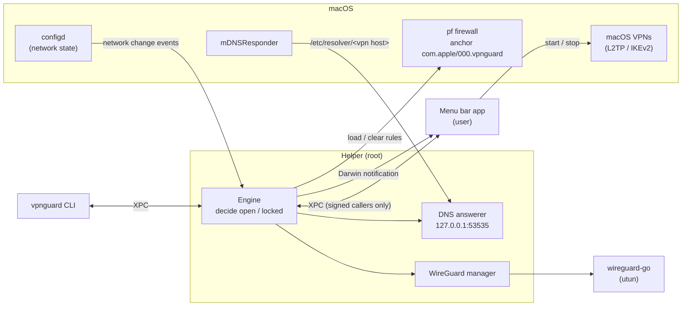

# Architecture

VPN Guard has three parts: a menu bar **app** (runs as you), a **helper** (a LaunchDaemon that runs as
root), and the **WireGuard engine** (`wireguard-go`, started by the helper). The helper does
everything that needs root; the app only shows state and sends requests.



## Source layout

| Path | What |
|---|---|
| `Sources/VPNGuardCore` | Shared code: models, policy, pf rule builder, WireGuard config/keys, DNS answer builder, profile builder, XPC client |
| `Sources/VPNGuardHelper` | The root helper and the `vpnguard` CLI (one binary) |
| `Sources/VPNGuard` | The SwiftUI menu bar app |
| `Tests/VPNGuardCoreTests` | Unit tests for everything in Core |
| `Resources/` | `Info.plist`, the launchd plist, install and uninstall scripts |
| `scripts/` | `build.sh`, `install.sh`, `make-icon.swift` |

## Files on disk

| Path | Owner / mode | What |
|---|---|---|
| `/Applications/VPN Guard.app` | user | The app (the helper and engine ship inside it) |
| `/Library/PrivilegedHelperTools/local.vpnguard.helper` | root 0755 | The helper and CLI |
| `/Library/PrivilegedHelperTools/local.vpnguard.wireguard-go` | root 0755 | The WireGuard engine |
| `/Library/LaunchDaemons/local.vpnguard.helper.plist` | root 0644 | Starts the helper at boot, keeps it alive |
| `/Library/Application Support/VPNGuard/config.json` | root 0644 | Settings, trusted networks, servers, WireGuard tunnels (no secrets) |
| `/Library/Application Support/VPNGuard/wireguard-keys.json` | root **0600** | WireGuard private and pre-shared keys |
| `/Library/Application Support/VPNGuard/clients.json` | root 0644 | Code hashes of the app copy that installed the helper (ad-hoc builds) |
| `/etc/resolver/<vpn host>` | root 0644 | Sends only that VPN server name to the helper's DNS answerer |
| `/var/run/vpnguard.pftoken` | root | pf enable reference |
| `/var/run/vpnguard-dns.json` | root | Original DNS settings while WireGuard overrides them (crash backup) |
| `/var/log/vpnguard.log` | root 0644 | Helper log |
| `/usr/local/bin/vpnguard` | symlink | The CLI |

## The decision

`Policy.decide` (Core) turns the config and the current networks into a mode and a reason. When in
doubt it locks:

| Situation | Mode | Reason |
|---|---|---|
| Protection off | open | `disabled` |
| Going to sleep, or just woken and the routers not read again yet (`WakeGuard`) | **locked** | `resolving` |
| Paused, the pause has not ended, and no new router has appeared since it started | open | `paused` |
| No network with a router | **locked** | `noNetwork` |
| No trusted network, and a known router that is not trusted | **locked** | `untrusted` |
| No trusted network, and router hardware addresses not known yet | **locked** | `resolving` |
| Some networks trusted, others not (e.g. office Wi‑Fi + iPhone USB) | **locked**, trusted cards open | `mixed` |
| Every active network is trusted | open | `trusted` |

**Sleep and wake.** The helper watches IOKit power messages. Before the Mac sleeps it locks (the
Mac waits for that answer), because it may wake up somewhere else: lid closed at home, opened at a
café. On wake it empties the ARP table and pings the routers every second; a router counts only once
it answered again since the wake, so the old place's hardware address that macOS may still show does
not open anything. Then the normal decision runs (at home: open again within about a second after
Wi‑Fi is back). After 60 s the check ends anyway (some USB modems never show a hardware address). A
pause continues after the wake only if the router is the same.

## Network detection

The helper subscribes to configd (`SCDynamicStore`) for `State:/Network/Service/*/IPv4` and `/DNS`,
`State:/Network/Interface/*/IPv4` and `/Link`, and the global IPv4 key. Each event runs one evaluation
on a serial queue; there is no polling. A 30-second safety timer also re-checks everything.

For each active interface with a router it reads the router's hardware address from configd's
`ARPResolvedHardwareAddress` (configd resolves it for its "network signature"). If that is missing, it
asks `/usr/sbin/arp` (the raw ARP sysctl hides addresses from programs without Apple's neighbor-cache
entitlement), and if that fails too it pings the router once (allowed by the lock rules) and tries
again with back-off.

Tunnel and loopback interfaces (`utun*`, `ppp*`, `ipsec*`, `lo*`) are never counted as networks.

## Firewall

VPN Guard never edits `/etc/pf.conf`. Its rules live in the anchor `com.apple/000.vpnguard`, a child of
the stock `anchor "com.apple/*"`. Child anchors are evaluated in name order, so `000.` runs before
Apple's own anchors, and its `quick` rules end the evaluation.

Lock mode loads these rules (`PFRules.lockRules`):

```pf
pass quick on { lo0 utun0 … utun15 ppp0 … ppp3 ipsec0 … ipsec3 <VM bridges> } all no state
pass out quick inet proto udp from any port 68 to any port 67 no state     # DHCP
pass in  quick inet proto udp from any port 67 to any port 68 no state
pass out quick inet proto icmp from any to { <routers> } icmp-type echoreq keep state
pass out quick inet from any to { <VPN server IPs> } no state
pass in  quick inet from { <VPN server IPs> } to any no state
block return out quick all
block drop in quick all
```

- Tunnels and local VM bridges are passed because whatever they send to the internet leaves through
  a real interface later, where it is filtered. Any new tunnel interface triggers a rule rebuild.
- On NAT64 networks (macOS publishes the prefix in `State:/Network/Interface/<card>/NAT64`), the VPN
  servers are also allowed under their IPv6 form (`NAT64.synthesize`, RFC 6052), with ICMPv6 router and
  neighbor messages. macOS uses that form when it connects through such a network.
- In `mixed`, a line `pass quick on { <trusted cards> } all no state` comes right after the first one,
  so those cards work as normal while the untrusted ones stay VPN only. When the lock starts, pf states
  are flushed only on the untrusted cards (`pfctl -i <card> -F states`). The app starts the VPN in
  `mixed` only when macOS sends traffic through an untrusted card (`GuardStatus.primaryInterface`).
- While there is no network or a router is still being checked (`noNetwork`, `resolving`), the last
  line is `block drop` instead, so a Wi‑Fi blip at a trusted place does not reset open connections.
- Everything else, **IPv6 included**, is refused. `block return` makes apps fail fast instead of
  hanging.
- Every input is validated again before it reaches pfctl (IPv4 only, interface names letters and
  digits only), so a bad config cannot inject rules. Unit tests cover this.
- When the mode changes from open to locked, the helper flushes pf states, so a connection made before
  the lock (or during a pause) cannot keep running outside the VPN.
- pf is enabled with a reference token (`pfctl -E`), so other software that uses pf keeps working.
  The safety timer checks that pf is still enabled, the anchor point exists and the rules are loaded,
  and repairs them if not.
- Open mode clears the anchor.

## VPN servers by host name

The allowed-server list (`GuardConfig.serverHosts`) holds the servers of **every** macOS VPN (the app
keeps it in step with System Settings, `ServerList.merge`; servers typed by hand stay), every
WireGuard endpoint, and nothing else. So switching VPN while locked never removes a server. IPs go
straight into the rules. For host names:

1. The helper looks them up with `dig -4 -b 0.0.0.0#53530` (directly against DNS, ignoring local
   overrides): at start, when the list changes, when the lock turns on or off, when the app reports a
   VPN that failed to connect (`lookUpServers`), every 30 s while one has no IP, every 5 min while
   locked, otherwise every 10 min. A request that arrives during a lookup runs right after it.
2. **While locked**, the helper adds `pass out quick inet proto udp from any port 53530 to any port
   53 keep state` to the rules only for the duration of its own lookup (normally under a second),
   then removes it. Lookups also run whenever the set of networks changes; none while there is none. pf on macOS does not apply `user root` to these packets (measured), so time is
   the guard. If pfctl ever rejects the line, the helper locks without it and logs that. Failed
   lookups are logged ("Could not look up VPN server …").
3. Looked-up IPs are a cache (`GuardConfig.hostIPs`): a server leaving the list keeps its IP (capped
   at 32 names), so choosing it again works at once. The IPs of listed servers are allowed in the
   rules (`GuardConfig.allowedIPs`).
4. A tiny DNS answerer in the helper listens on `127.0.0.1:53535` and answers **only** those names
   (type A with the saved IPs; other names get NXDOMAIN). A file `/etc/resolver/<host>` tells
   mDNSResponder to ask it for that one name. So the VPN client can find its server while all other
   DNS is blocked, and nothing leaves the Mac. `/etc/hosts` is never touched.

## WireGuard

The helper runs one tunnel at a time with the bundled `wireguard-go` (userspace, no Network Extension
needed), following the same steps as `wg-quick` on macOS:

1. Start `wireguard-go -f utun` with `WG_TUN_NAME_FILE`, wait for its control socket.
2. Add a host route to the server through the router of the network macOS really uses (the
   untunnelled default route from `netstat`, else the service order; `vpnguard detect` shows it). Even the first handshake then leaves through the real network, and
   the route is updated when the network changes.
3. Configure the engine over its control socket (`set=1`, keys in hex, endpoint IP, allowed IPs,
   keepalive).
4. Add the addresses (`ifconfig … alias`), MTU, and routes: `0.0.0.0/1` and `128.0.0.0/1` (and `::/1`,
   `8000::/1`) for a full tunnel, otherwise each allowed range.
5. For a full tunnel, publish the tunnel to configd like a macOS VPN does
   (`State:/Network/Service/VPNGuard-WireGuard/IPv4` with `OverridePrimary`) **and** put the tunnel's
   DNS servers on the current primary service, restoring the original afterwards. The second step is
   needed because configd may keep another VPN as primary; it is re-applied after every network change
   because DHCP rewrites it. A backup file restores DNS after a crash.

The engine is restarted with back-off if it stops. Status (handshake time, bytes) comes from the
control socket. On SIGTERM (update, uninstall) the helper takes the tunnel down cleanly.

Private keys arrive from the app over XPC once and are stored in a root-only (0600) file written with
`O_EXCL`; the config file and every status sent to the app contain only the public key.

## macOS VPNs

The app watches and controls the chosen macOS VPN with `SCNetworkConnection` (the API behind
`scutil --nc`), in the user's session so the saved password is used. New L2TP or IKEv2 VPNs are created
as Apple configuration profiles (`com.apple.vpn.managed`, `OverridePrimary = 1`) that the user approves
once; the profile file is readable only by the user and deleted after 10 minutes.

## App ↔ helper

- **XPC** over the Mach service `local.vpnguard.helper.xpc`, one method with a JSON payload
  (`HelperCommand` → `HelperReply`).
- **Who may call:** the helper sets a code-signing requirement on every connection, built and
  validated by `ClientTrust` (Core, unit tested):
  - signed with a certificate: `anchor apple generic and certificate leaf[subject.OU] = "<own team
    ID>" and (identifier "local.vpnguard.app" or identifier "local.vpnguard.helper")`;
  - ad-hoc (the DMG): `cdhash H"<own>" or cdhash H"<app arm64>" or cdhash H"<app x86_64>"`. The app
    hashes come from `clients.json`, written by `vpnguard pin-app` (root only) inside
    `install-helper.sh`, right after the user typed the admin password. `pin-app` checks the app's
    signature and identifier first. No valid hash at all gives `never` (fail closed).
- All binaries are signed with the hardened runtime, so the pinned processes cannot be injected into.
- **Push updates:** the helper posts the Darwin notification `local.vpnguard.status` when its state
  changes; the app then fetches the status. The app also refreshes every 10 s.
- **Auto VPN** lives in the app (decisions in Core `AutoVPN`, unit tested):
  - locked because a network is untrusted, or because a router's hardware address is still unknown
    after 5 s: start the chosen VPN (back-off 0, 5, 15, 30, 60 s);
  - an L2TP/PPTP VPN whose network (card + address + router) is gone while another network is up:
    restart it at once (macOS waits up to 80 s); with no network at all it waits;
  - a macOS VPN that failed to connect: ask the helper to look the server names up again;
  - your Connect / Disconnect choice is kept when the same network comes back within 10 minutes
    (Wi‑Fi blip, short sleep), and forgotten at a new network (`AutoVPN.isNewNetwork`);
  - with two networks up, the card an L2TP VPN uses is taken from the route to its server;
  - arrival at a trusted network: stop it once;
  - switching VPN stops the old one by asking macOS directly (`stopService`), not the watcher.
- **Trusting** makes one entry per router (`TrustedNetwork.newEntries`), even over Wi-Fi + cable.

## The app

SwiftUI `MenuBarExtra` (window style) plus two windows (Settings, Welcome). The menu bar icon is a
template image drawn in code (`GuardGlyph`) from the same 24-unit shield geometry as the app icon and
the popover. The status orb (`ProtectionOrb`) animates with a `TimelineView` at 30 fps only while
visible, respects Reduce Motion, and toggles protection on a 0.7 s press and hold.

### When the VPN fails

`AppModel` keeps two ids: the **chosen** VPN (`selectedVPNID`, the ✓, saved) and the VPN **in use**
(`activeVPNID`: the chosen one, or `backupVPNID` while a backup stands in for it on this network).

- A macOS VPN attempt that ends "disconnected" without having been "connected" is a failed try, unless
  VPN Guard or the user stopped it. For L2TP / PPTP the reason comes from the end of `/var/log/ppp.log`
  (`PPPLog.lastFailure`, only lines of this attempt and this server), else from pppd's exit code
  (`LastCause` in the extended status), else "could not connect". WireGuard has no failed event:
  25 s without a handshake counts as failed.
- `BackupVPN.next` picks the next VPN after 3 failed tries: list order, full-tunnel only, never one
  that already failed on this network. When all failed, the chosen VPN is tried again with back-off.
  A new network, *Try Again*, or choosing another VPN starts over with the chosen one.
- `Notices.decide` says when a notification is due (blocked for 20 s or 3 failed tries, backup in use,
  protected again); `Notifier` sends it with UserNotifications.
- The protection test (`ProtectionProbe` + `LeakTest`) opens sockets bound to one network card
  (`IP_BOUND_IF`, like `ping -b`), so the VPN's routes do not apply, and tries TCP 443 and UDP 53 to
  1.1.1.1 (and IPv6 if the card has it). pf must stop all of them. `VPNGuard --probe en0` prints the
  raw results.

## Release builds

`.github/workflows/release.yml` runs on every `v*` tag: unit tests, then `UNIVERSAL=1 SIGN_IDENTITY=-
scripts/build.sh` (Swift for arm64 + x86_64, wireguard-go built per architecture with `go build` and
joined with `lipo`, everything ad-hoc signed with the hardened runtime), then `scripts/make-dmg.sh`
(drag-to-Applications DMG with a short "How to open" note, plus a SHA-256 file), and attaches both to
the GitHub release. `install-helper.sh` clears the quarantine flag on the files it copies, because
launchd will not start a quarantined helper.

## Previews

`VPNGuard --render-previews <dir>` renders every screen in light and dark mode with made-up data,
without a helper. It is used to check the UI and to make the screenshots in this repo.
