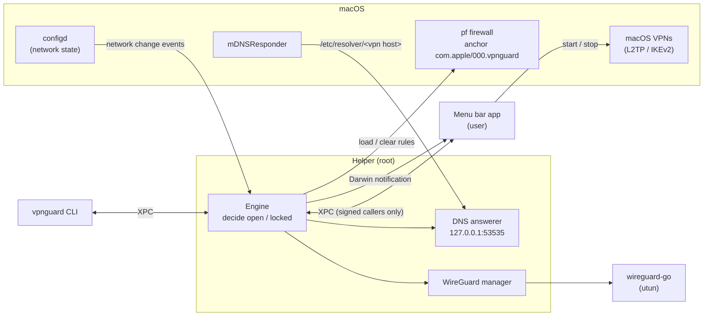

# Architecture

VPN Guard has three parts: a menu bar **app** (runs as you), a **helper** (a LaunchDaemon that runs as
root), and the **WireGuard engine** (`wireguard-go`, started by the helper). The helper does
everything that needs root; the app only shows state and sends requests.



## Source layout

| Path | What |
|---|---|
| `Sources/VPNGuardCore` | Shared code: models, policy, pf rule builder, WireGuard config/keys, DNS answer builder, profile builder, XPC client |
| `Sources/VPNGuardHelper` | The root helper and the `vpnguard` CLI (one binary) |
| `Sources/VPNGuard` | The SwiftUI menu bar app |
| `Tests/VPNGuardCoreTests` | Unit tests for everything in Core |
| `Resources/` | `Info.plist`, the launchd plist, install and uninstall scripts |
| `scripts/` | `build.sh`, `install.sh`, `make-icon.swift` |

## Files on disk

| Path | Owner / mode | What |
|---|---|---|
| `/Applications/VPN Guard.app` | user | The app (the helper and engine ship inside it) |
| `/Library/PrivilegedHelperTools/local.vpnguard.helper` | root 0755 | The helper and CLI |
| `/Library/PrivilegedHelperTools/local.vpnguard.wireguard-go` | root 0755 | The WireGuard engine |
| `/Library/LaunchDaemons/local.vpnguard.helper.plist` | root 0644 | Starts the helper at boot, keeps it alive |
| `/Library/Application Support/VPNGuard/config.json` | root 0644 | Settings, trusted networks, servers, WireGuard tunnels (no secrets) |
| `/Library/Application Support/VPNGuard/wireguard-keys.json` | root **0600** | WireGuard private and pre-shared keys |
| `/etc/resolver/<vpn host>` | root 0644 | Sends only that VPN server name to the helper's DNS answerer |
| `/var/run/vpnguard.pftoken` | root | pf enable reference |
| `/var/run/vpnguard-dns.json` | root | Original DNS settings while WireGuard overrides them (crash backup) |
| `/var/log/vpnguard.log` | root 0644 | Helper log |
| `/usr/local/bin/vpnguard` | symlink | The CLI |

## The decision

`Policy.decide` (Core) turns the config and the current networks into a mode and a reason. When in
doubt it locks:

| Situation | Mode | Reason |
|---|---|---|
| Protection off | open | `disabled` |
| Paused and the pause has not ended | open | `paused` |
| No network with a router | **locked** | `noNetwork` |
| A known router that is not trusted | **locked** | `untrusted` |
| A router whose hardware address is not known yet | **locked** | `resolving` |
| Every active network is trusted | open | `trusted` |

## Network detection

The helper subscribes to configd (`SCDynamicStore`) for `State:/Network/Service/*/IPv4` and `/DNS`,
`State:/Network/Interface/*/IPv4` and `/Link`, and the global IPv4 key. Each event runs one evaluation
on a serial queue; there is no polling. A 30-second safety timer also re-checks everything.

For each active interface with a router it reads the router's hardware address from configd's
`ARPResolvedHardwareAddress` (configd resolves it for its "network signature"). If that is missing, it
asks `/usr/sbin/arp` (the raw ARP sysctl hides addresses from programs without Apple's neighbor-cache
entitlement), and if that fails too it pings the router once (allowed by the lock rules) and tries
again with back-off.

Tunnel and loopback interfaces (`utun*`, `ppp*`, `ipsec*`, `lo*`) are never counted as networks.

## Firewall

VPN Guard never edits `/etc/pf.conf`. Its rules live in the anchor `com.apple/000.vpnguard`, a child of
the stock `anchor "com.apple/*"`. Child anchors are evaluated in name order, so `000.` runs before
Apple's own anchors, and its `quick` rules end the evaluation.

Lock mode loads these rules (`PFRules.lockRules`):

```pf
pass quick on { lo0 utun0 … utun15 ppp0 … ppp3 ipsec0 … ipsec3 <VM bridges> } all no state
pass out quick inet proto udp from any port 68 to any port 67 no state     # DHCP
pass in  quick inet proto udp from any port 67 to any port 68 no state
pass out quick inet proto icmp from any to { <routers> } icmp-type echoreq keep state
pass out quick inet from any to { <VPN server IPs> } no state
pass in  quick inet from { <VPN server IPs> } to any no state
block return out quick all
block drop in quick all
```

- Tunnels and local VM bridges are passed because whatever they send to the internet leaves through
  a real interface later, where it is filtered. Any new tunnel interface triggers a rule rebuild.
- Everything else, **IPv6 included**, is refused. `block return` makes apps fail fast instead of
  hanging.
- Every input is validated again before it reaches pfctl (IPv4 only, interface names letters and
  digits only), so a bad config cannot inject rules. Unit tests cover this.
- When the mode changes from open to locked, the helper flushes pf states, so a connection made before
  the lock (or during a pause) cannot keep running outside the VPN.
- pf is enabled with a reference token (`pfctl -E`), so other software that uses pf keeps working.
  The safety timer checks that pf is still enabled, the anchor point exists and the rules are loaded,
  and repairs them if not.
- Open mode clears the anchor.

## VPN servers by host name

The allowed-server list (`GuardConfig.serverHosts`) holds the chosen macOS VPN's server and every
WireGuard endpoint. IPs go straight into the rules. For host names:

1. The helper looks them up with `dig` (directly against DNS, ignoring local overrides) at start,
   when the list changes, and every 10 minutes (every 30 s while one has no IP yet). While locked with
   the VPN down, that query is blocked by pf, and the last good answer is kept.
2. The IPs are allowed in the rules (`GuardConfig.allowedIPs`).
3. A tiny DNS answerer in the helper listens on `127.0.0.1:53535` and answers **only** those names
   (type A with the saved IPs; other names get NXDOMAIN). A file `/etc/resolver/<host>` tells
   mDNSResponder to ask it for that one name. So the VPN client can find its server while all other
   DNS is blocked, and nothing leaves the Mac. `/etc/hosts` is never touched.

## WireGuard

The helper runs one tunnel at a time with the bundled `wireguard-go` (userspace, no Network Extension
needed), following the same steps as `wg-quick` on macOS:

1. Start `wireguard-go -f utun` with `WG_TUN_NAME_FILE`, wait for its control socket.
2. Add a host route to the server through the current router (so even the first handshake leaves
   through the real network), and keep it updated when the network changes.
3. Configure the engine over its control socket (`set=1`, keys in hex, endpoint IP, allowed IPs,
   keepalive).
4. Add the addresses (`ifconfig … alias`), MTU, and routes: `0.0.0.0/1` and `128.0.0.0/1` (and `::/1`,
   `8000::/1`) for a full tunnel, otherwise each allowed range.
5. For a full tunnel, publish the tunnel to configd like a macOS VPN does
   (`State:/Network/Service/VPNGuard-WireGuard/IPv4` with `OverridePrimary`) **and** put the tunnel's
   DNS servers on the current primary service, restoring the original afterwards. The second step is
   needed because configd may keep another VPN as primary; it is re-applied after every network change
   because DHCP rewrites it. A backup file restores DNS after a crash.

The engine is restarted with back-off if it stops. Status (handshake time, bytes) comes from the
control socket. On SIGTERM (update, uninstall) the helper takes the tunnel down cleanly.

Private keys arrive from the app over XPC once and are stored in a root-only (0600) file written with
`O_EXCL`; the config file and every status sent to the app contain only the public key.

## macOS VPNs

The app watches and controls the chosen macOS VPN with `SCNetworkConnection` (the API behind
`scutil --nc`), in the user's session so the saved password is used. New L2TP or IKEv2 VPNs are created
as Apple configuration profiles (`com.apple.vpn.managed`, `OverridePrimary = 1`) that the user approves
once; the profile file is readable only by the user and deleted after 10 minutes.

## App ↔ helper

- **XPC** over the Mach service `local.vpnguard.helper.xpc`, one method with a JSON payload
  (`HelperCommand` → `HelperReply`).
- **Who may call:** the helper sets a code-signing requirement on every connection:
  `anchor apple generic and certificate leaf[subject.OU] = "<its own team ID>" and (identifier
  "local.vpnguard.app" or identifier "local.vpnguard.helper")`. With an ad-hoc build there is no team
  ID, so only the identifiers are checked (weaker; see [SECURITY.md](../SECURITY.md)).
- **Push updates:** the helper posts the Darwin notification `local.vpnguard.status` when its state
  changes; the app then fetches the status. The app also refreshes every 10 s.
- **Auto VPN** lives in the app: on an untrusted network it starts the chosen VPN (with back-off), and
  on arrival at a trusted network it stops it once.

## The app

SwiftUI `MenuBarExtra` (window style) plus two windows (Settings, Welcome). The menu bar icon is a
template image drawn in code (`GuardGlyph`) from the same 24-unit shield geometry as the app icon and
the popover. The status orb (`ProtectionOrb`) animates with a `TimelineView` at 30 fps only while
visible, respects Reduce Motion, and toggles protection on a 0.7 s press and hold.

`VPNGuard --render-previews <dir>` renders every screen in light and dark mode with made-up data,
without a helper. It is used to check the UI and to make the screenshots in this repo.
