# User guide

This guide shows how to set up and use VPN Guard. For how it works inside, see
[ARCHITECTURE.md](ARCHITECTURE.md).

- [1. First run](#1-first-run)
- [2. The menu bar](#2-the-menu-bar)
- [3. Trusted networks](#3-trusted-networks)
- [4. VPNs](#4-vpns)
- [5. WireGuard on a MikroTik router](#5-wireguard-on-a-mikrotik-router)
- [6. Pause (hotel and café login pages)](#6-pause-hotel-and-café-login-pages)
- [7. Settings](#7-settings)
- [8. Command line](#8-command-line)
- [9. Logs, updates, uninstall](#9-logs-updates-uninstall)

## 1. First run

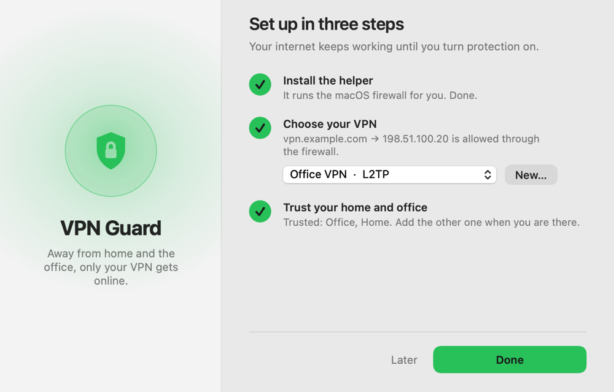

Download the DMG from the [latest release](https://github.com/hkvn/vpn-guard/releases/latest), drag
VPN Guard to Applications and open it. The first time, macOS blocks it because this free build is not
notarized by Apple: click **Done**, then **System Settings → Privacy & Security → Open Anyway** (see the
[README](../README.md#install)). VPN Guard then opens a welcome window with three steps:

1. **Install the helper.** A small program that runs as root and controls the macOS firewall (pf).
   macOS asks for your password once.
2. **Choose your VPN.** Pick a VPN you already have in System Settings, or press **New…** to add one.
   WireGuard is built in.
3. **Trust your home and office.** When you are on one of them, press **Trust This Network…** and give
   it a name. Do the other one when you are there.

Then press **Turn On Protection**. Until you do, VPN Guard changes nothing on your network.

## 2. The menu bar

### The icon

The shield in the menu bar shows the state at a glance:

| Icon | Meaning |
|---|---|
| Filled shield with a lock | **Protected.** Untrusted network, all traffic goes through the VPN. |
| Shield with a check mark | **Trusted network.** Normal internet. |
| Shield with three dots | **Connecting** (the VPN is starting) or checking the network. |
| Shield with an X | **Blocked.** Untrusted network and the VPN is off: nothing gets out. |
| Shield with a pause sign | **Paused.** Normal internet for a few minutes. |
| Dashed shield | **Protection is off.** |
| Shield with "!" | **Needs attention.** The helper is missing or not answering. |

Prefer colors? In **Settings → General → Menu bar icon**, choose **Color**: Protected green, Trusted
blue, Connecting orange, Blocked red, Paused yellow, Off gray, Attention purple.

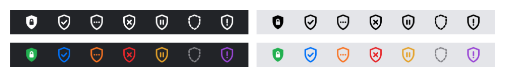

### The popover

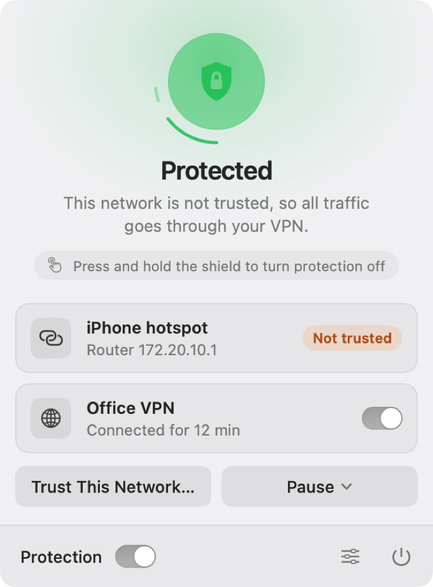
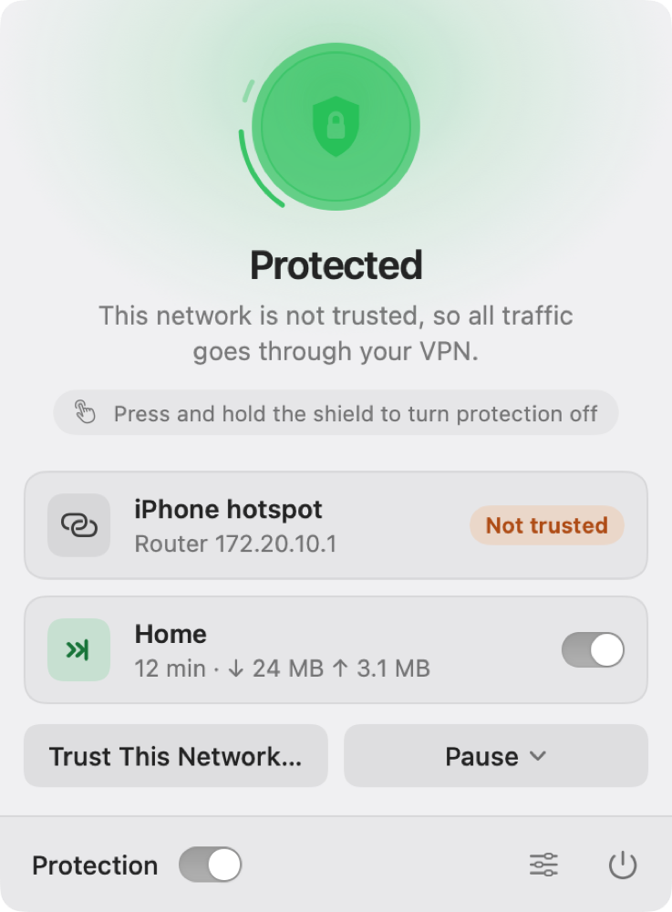

Click the icon to open it. From top to bottom:

- **Status shield.** It moves gently to show the state (a slow light arc when protected, a fast one
  when connecting). **Press and hold it for a moment** to turn protection off or on. A ring fills
  while you hold; let go early and nothing happens. This way a quick click can never turn protection
  off by mistake.
- **Network card.** The network you are on and whether it is trusted.
- **VPN card.** Your VPN, its state (for WireGuard also time and data used) and a switch to connect
  or disconnect.
- **Main button**, when there is something to do: *Connect VPN*, *Resume Protection*, *Turn On
  Protection*, *Install Helper…*
- **Trust This Network…** and **Pause**.
- **Protection** switch, **Settings** and **Quit**.

## 3. Trusted networks

A trusted network is one where you do not need the VPN, usually your home and your office.

**To trust a network:** connect to it, then press **Trust This Network…** (in the popover or in
Settings → Networks) and give it a name such as *Office* or *Home*.

**How VPN Guard recognizes it:** by the hardware (MAC) address of the network's router, not by the
Wi‑Fi name. Anyone can create a Wi‑Fi with the same name as yours; copying your router's hardware
address is much harder.

Good to know:

- If the office router is replaced, trust the network again.
- If the Mac is on **two networks at once** (for example office Wi‑Fi and an iPhone over USB), each one
  is judged on its own. The trusted one works as normal; the other may only be used by the VPN
  (**VPN only**). If macOS sends your traffic through the untrusted one, the VPN starts and everything
  goes through it.

  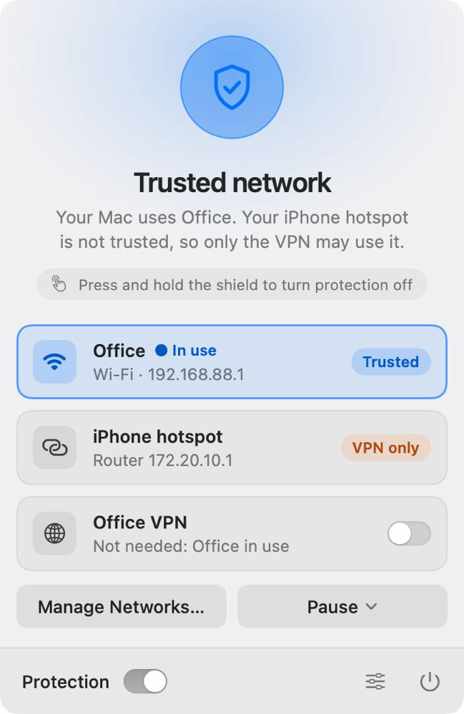

- When you press **Trust This Network…** while the Mac is on several networks, or on a phone hotspot,
  VPN Guard asks **which** network to trust. Only the network your Mac uses is ticked. A phone hotspot is
  never ticked for you and shows a warning: it goes everywhere with your phone, so trusting it would
  turn the VPN off wherever you use that phone.

  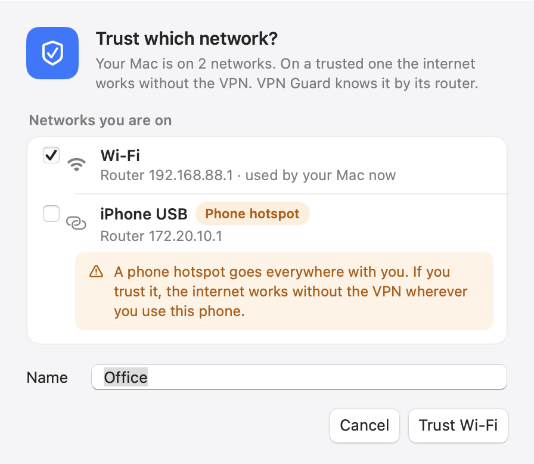
- An iPhone hotspot is never trusted unless you trust it yourself.

**Settings → Networks** shows each network you are on: your address, the router and its hardware
address, DNS servers, since when it is trusted, and whether your internet goes out there. With two
networks, the one in use is first and framed.

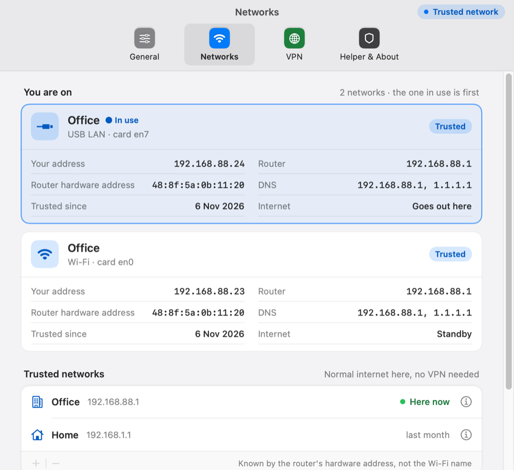

Manage the list in **Settings → Networks**: ⓘ shows the details, right-click to rename or remove, or
use the **+ / −** buttons.

## 4. VPNs

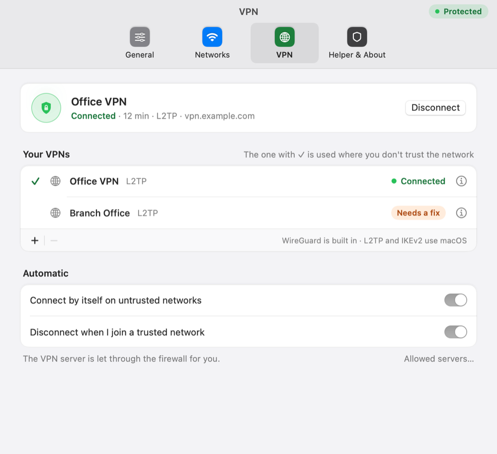

Settings → **VPN** lists every VPN VPN Guard can use. The one with **✓** is used on untrusted
networks. Click a row to choose it; ⓘ shows details.

### Add a VPN

Press **+** (or *New…* in the welcome window) and choose a type.

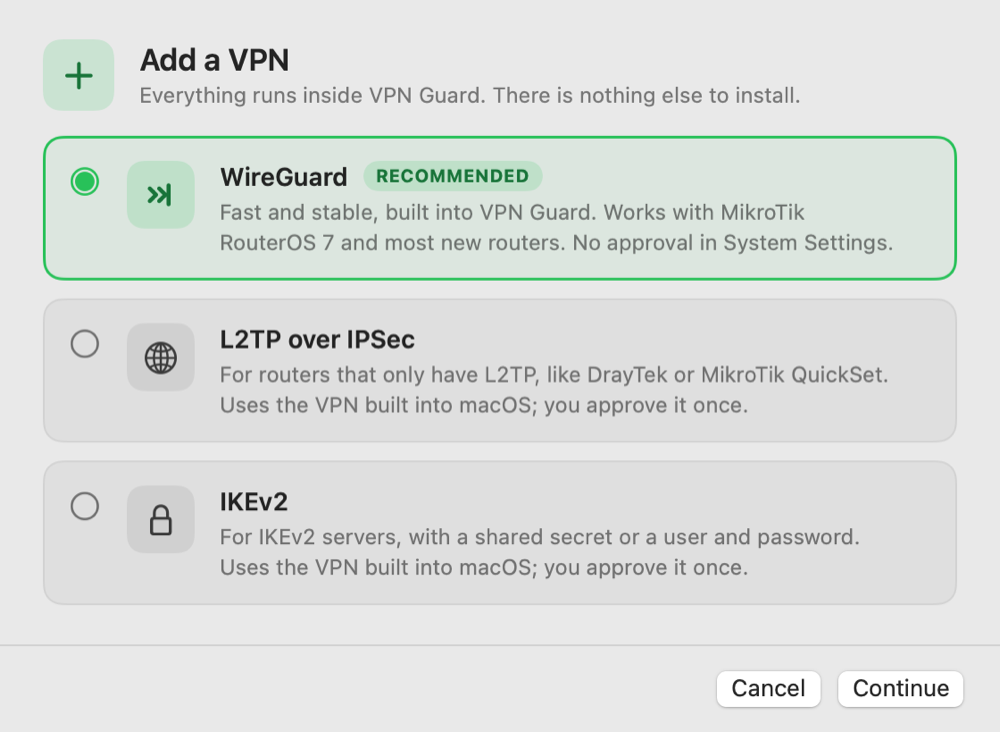

**WireGuard (recommended).** Built into VPN Guard; nothing else to install and no approval in System
Settings. Two ways:

- **Import a file.** Drop the `.conf` file your router or VPN admin gave you, or press *Choose File…*
  or *Paste*. VPN Guard shows what it found before you add it.
- **Create new keys.** Fill in the server (`host:port`), the server's public key, your address inside
  the VPN (for example `10.8.0.2/32`) and a DNS server. VPN Guard makes a key pair, shows **your public
  key**, and gives you a ready **MikroTik command** to add this Mac on the router. See
  [section 5](#5-wireguard-on-a-mikrotik-router).

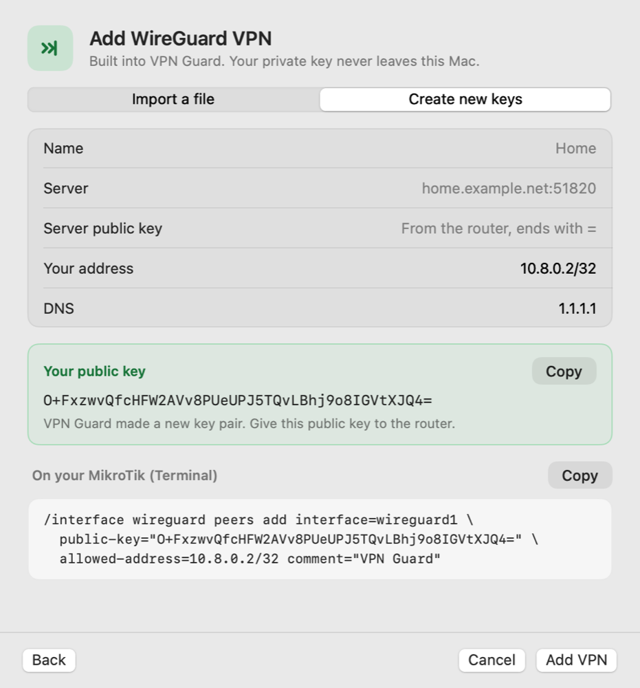

Your private key never leaves the Mac. It is stored in a file only root can read.

**L2TP over IPSec / IKEv2.** These use the VPN built into macOS. Fill in name, server, account,
password and shared secret. VPN Guard writes an Apple configuration profile with *Send all traffic*
turned on, and macOS asks you to approve it once:

1. System Settings opens at **General → Device Management**.
2. Double-click the profile **VPN Guard: <name>**.
3. Click **Install** and type your Mac password.

The add window closes by itself when the new VPN appears. macOS keeps the password and secret in its
own keychain; VPN Guard does not store them.

### VPNs you already have

VPN Guard lists the VPNs from System Settings → VPN. Two settings matter:

- **Send all traffic over VPN connection** must be **on** (System Settings → VPN → ⓘ → Options).
  If it is off, websites stay blocked even when the VPN is connected. VPN Guard marks such a VPN
  **Needs a fix**; its ⓘ sheet has a button to open System Settings and one to make a correct copy.
- **Connect once from System Settings** so macOS saves the password.

VPNs from other apps (for example Tailscale) are listed as *Other app*. VPN Guard can start and stop
them, but cannot check their settings.

### Server host names

If your VPN server is a host name (like `vpn.example.com`) rather than an IP address, VPN Guard looks
up its IP and lets that IP through the firewall. While blocked, DNS is off for your apps, so VPN Guard
answers that one name itself, on your Mac, with the IP it saved.

The servers of **all** your VPNs are in the list, not only the one you chose, so switching VPN while
blocked works at once. VPN Guard looks the names up again when the lock turns on or off, every few
minutes, and right after a VPN fails to connect, so a home server whose IP changes (dynamic DNS) is
found again even while you are blocked. You can see the list in Settings → VPN → **Allowed servers…**

### Automatic

- **Connect by itself on untrusted networks.** VPN Guard starts your VPN when the network is not
  trusted, and tries again with growing pauses if it fails. If you disconnect it yourself, it waits
  until you change network; a short Wi‑Fi drop or sleep on the same network keeps your choice. When
  you move to another network, an L2TP VPN is restarted at once (macOS alone would keep a dead
  connection for up to 80 seconds).
- **Disconnect when I join a trusted network.** Once, on arrival. You can connect again by hand.
- **Protection off or paused** means normal internet: VPN Guard disconnects the VPN it started by
  itself, and starts it again when protection comes back. A VPN you connected by hand stays on.

Only one VPN runs at a time: choosing another VPN disconnects the old one.

## 5. WireGuard on a MikroTik router

RouterOS 7 has WireGuard built in. These steps make the router a WireGuard server for your Mac. Adapt
the names, addresses and port to your network, and check them against your own firewall rules.

**On the router** (WinBox → New Terminal, or SSH):

```routeros
# 1. A WireGuard interface and an address for the VPN network
/interface wireguard add name=wireguard1 listen-port=13231
/ip address add address=10.8.0.1/24 interface=wireguard1

# 2. Let WireGuard in from the internet (put this before your drop rules)
/ip firewall filter add chain=input protocol=udp dst-port=13231 action=accept comment="WireGuard"

# 3. Show the router's public key: copy it into "Server public key" in VPN Guard
/interface wireguard print
```

**In VPN Guard:** Add VPN → WireGuard → **Create new keys**:

| Field | Example |
|---|---|
| Name | Home |
| Server | `your-public-ip-or-ddns-name:13231` |
| Server public key | from step 3 |
| Your address | `10.8.0.2/32` |
| DNS | `1.1.1.1` |

Press **Copy** next to *On your MikroTik (Terminal)* and run that command on the router. It looks like:

```routeros
/interface wireguard peers add interface=wireguard1 \
  public-key="<your Mac's public key>" \
  allowed-address=10.8.0.2/32 comment="VPN Guard Home"
```

Then press **Add VPN** and connect. Traffic from the VPN network usually leaves through your normal
internet masquerade rule. If websites do not open through the VPN, check that your `forward` chain
accepts traffic from `wireguard1` and that your masquerade rule covers `10.8.0.0/24`.

## 6. Pause (hotel and café login pages)

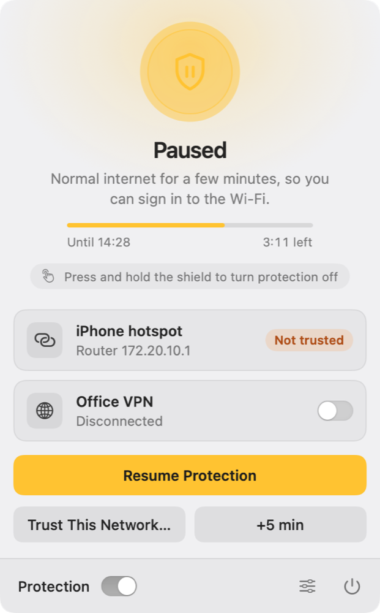

Many hotel and café Wi‑Fi networks show a login page before they let you online. That page cannot load
through your VPN. Use **Pause** (5 minutes, 15 minutes or 1 hour), sign in, then press **Resume
Protection** or simply wait: protection comes back by itself when the time is up. **+5 min** adds time.

While paused, traffic is **not** protected. A pause belongs to the network where you started it: if you
join another network (you leave the hotel, or plug in your iPhone), the pause ends at once. A short
Wi‑Fi drop on the same network keeps it.

## 7. Settings

Open it from the slider button in the popover. The menu is at the top:

- **General.** The protection switch, *Open VPN Guard at login*, and what each menu bar icon means.
- **Networks.** The network you are on, your trusted networks, and the main switch.
- **VPN.** The VPN in use, your VPN list, the automatic options, and the allowed servers.
- **Helper & About.** Version, helper status, firewall state, WireGuard engine, *Reinstall*, *Show
  Log*, *Uninstall*.

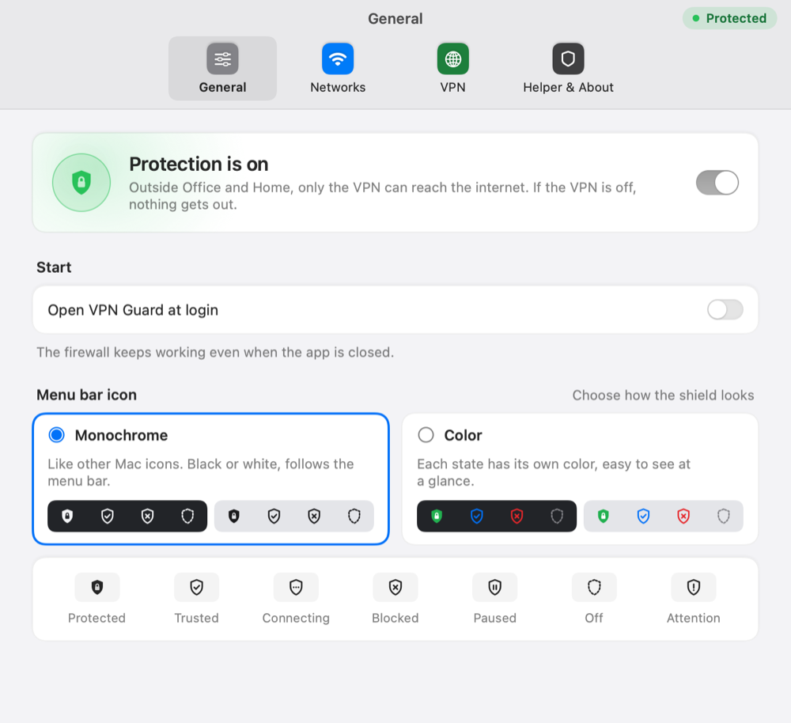

## 8. Command line

The helper installs a `vpnguard` command (in `/usr/local/bin`). It talks to the helper the same way
the app does.

| Command | What it does |
|---|---|
| `vpnguard status` | Show the state, networks, VPN servers and trusted networks |
| `vpnguard trust <name>` | Trust the network you are on |
| `vpnguard untrust <name>` | Remove a trusted network |
| `vpnguard pause <minutes>` | Normal internet for a few minutes (1–1440) |
| `vpnguard resume` | End a pause |
| `vpnguard enable` / `disable` | Turn protection on or off |
| `vpnguard servers [addr …]` | Set the VPN servers allowed through the firewall (IPs or host names) |
| `vpnguard wg list` | Show WireGuard VPNs and the running tunnel |
| `vpnguard wg import <file> [name]` | Add a WireGuard VPN from a `.conf` file |
| `vpnguard wg up <name>` / `wg down` | Connect / disconnect WireGuard |
| `vpnguard wg remove <name>` | Remove a WireGuard VPN and its keys |
| `vpnguard detect` | Show the networks and routers this Mac sees (no helper needed) |
| `vpnguard rules` | Print the firewall rules lock mode would use now |

## 9. Logs, updates, uninstall

**Logs:** Settings → Helper & About → **Show Log**, or:

```bash
tail -f /var/log/vpnguard.log
log stream --predicate 'subsystem == "local.vpnguard"'
```

**Updates:** download the new DMG and drag VPN Guard to Applications again (replace the old one).
The helper only takes orders from the exact app copy that installed it, so a new copy shows **Needs
attention** with **Reinstall Helper…** (or **Update Helper…**). Click it and type your password once.
Your trusted networks, VPNs and settings are kept, and the firewall stays on during the update.

If you build from source: pull and run `scripts/install.sh` again.

**Uninstall:** Settings → Helper & About → **Uninstall…** removes the helper, the firewall rules, the
WireGuard engine and the DNS files. Your trusted networks are kept unless you uninstall from Terminal
with `--purge`:

```bash
sudo bash "/Applications/VPN Guard.app/Contents/Resources/helper/uninstall-helper.sh" --purge
rm -rf "/Applications/VPN Guard.app"
```
